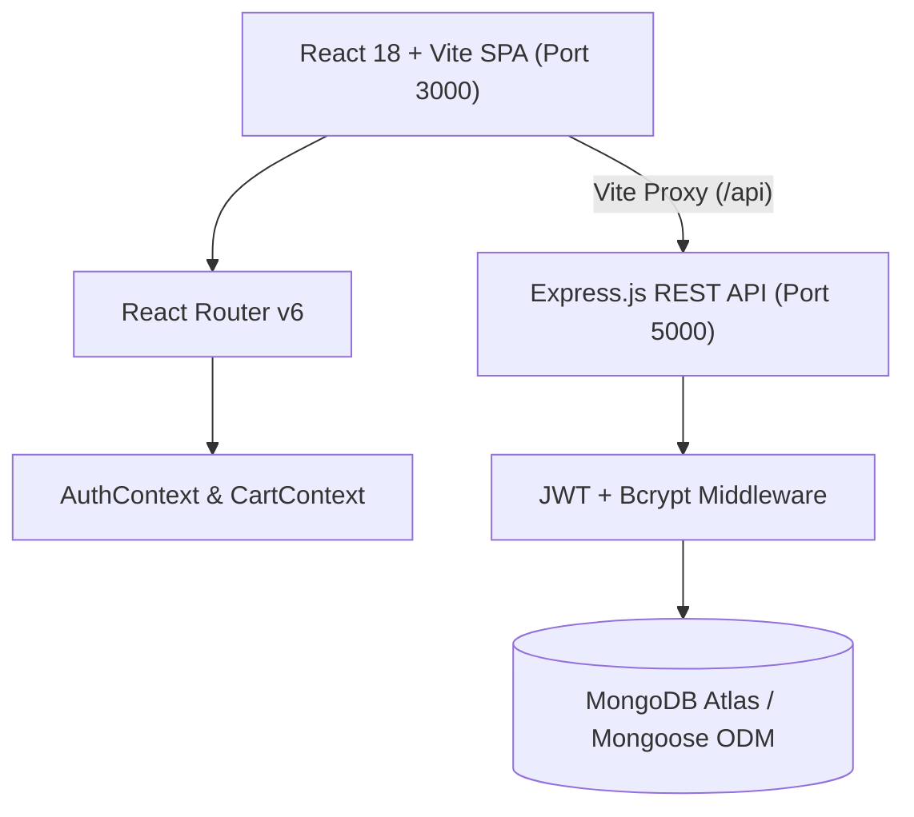

# 🎓 BRACU Bazaar — Campus Peer-to-Peer Marketplace

[](https://bracubazaar.netlify.app/)
[](https://react.dev/)
[](https://tailwindcss.com/)
[](https://nodejs.org/)
[](https://www.mongodb.com/atlas)
[](https://jwt.io/)
[](https://opensource.org/licenses/ISC)

> **BRACU Bazaar** is a dedicated full-stack peer-to-peer campus marketplace designed exclusively for students of **BRAC University (BRACU)**. It empowers students to buy, sell, and trade essential university supplies—such as engineering & business textbooks, scientific calculators, hostel appliances, electronics, and official university merchandise—with zero middleman commission and safe, hand-to-hand transactions at designated campus meetup locations.
>
> 🌐 **Live Demo Website**: [https://bracubazaar.netlify.app/](https://bracubazaar.netlify.app/)

---

## 📌 Table of Contents

- [Overview & Problem Statement](#-overview--problem-statement)
- [Key Features & Platform Modules](#-key-features--platform-modules)
  - [1. Campus Marketplace & Discovery](#1-campus-marketplace--discovery)
  - [2. Seller & Listing Management](#2-seller--listing-management)
  - [3. Cart, Checkout & Order Tracking](#3-cart-checkout--order-tracking)
  - [4. Real-Time Chat & Admin Moderation](#4-real-time-chat--admin-moderation)
- [System Architecture & Tech Stack](#-system-architecture--tech-stack)
- [Directory Structure](#-directory-structure)
- [Database Models & Schemas](#-database-models--schemas)
- [REST API Endpoints Reference](#-rest-api-endpoints-reference)
- [Getting Started & Local Setup](#-getting-started--local-setup)
  - [Prerequisites](#prerequisites)
  - [1. Backend Setup](#1-backend-setup)
  - [2. Frontend Setup](#2-frontend-setup)
  - [Automated Data Seeding](#automated-data-seeding)
- [Pre-Seeded Demo & Test Accounts](#-pre-seeded-demo--test-accounts)
- [Campus Meetup & Safety Guidelines](#-campus-meetup--safety-guidelines)
- [Deployment](#-deployment)
- [Project Author & Credits](#-project-author--credits)

---

## 💡 Overview & Problem Statement

At the start of every academic semester, BRACU students face recurring challenges:
1. **Expensive Course Materials**: Expensive textbooks, course packs, and mandatory lab calculators (e.g. Casio fx-991EX ClassWiz) are often purchased at retail prices and used for only 3–4 months.
2. **Scattered Trade Channels**: Students rely on unorganized Facebook groups or informal chats where spam, ghosting, and scam risks are frequent.
3. **Logistics & Delivery Inefficiencies**: Arranging courier services across Dhaka is costly and slow.

### The Solution:
**BRACU Bazaar** provides a unified, safe, and student-verified web platform where:
- Every user is validated by their unique **8-digit BRACU Student ID**.
- Transactions take place **in person on campus** (Merul Badda Permanent Campus Library Plaza/Cafeteria, Mohakhali UB2, or Tarakanda hostels).
- Transparent product condition grades, seller reputations, direct messaging, and an active moderation system ensure trust and security.

---

## 🚀 Key Features & Platform Modules

BRACU Bazaar is designed as an end-to-end full-stack campus commerce solution featuring 20 comprehensive capabilities:

### 1. Campus Marketplace & Discovery
1. **Browse All Product Listings**: Intuitive responsive gallery displaying all available items with images, pricing, categories, and condition badges.
2. **Keyword Search**: Real-time search engine querying product titles, descriptions, and categories.
3. **Category & Condition Filtering**: Filter by categories (*Textbooks & Notes*, *Calculators & Lab Gear*, *Electronics & Gadgets*, *Hostel Essentials*, *Fashion & Merchandise*, *Sports & Gaming*) and conditions (*Brand New*, *Like New*, *Good*, *Fair*).
4. **Dynamic Price & Pagination Controls**: Filter by minimum/maximum price bounds and view catalog items cleanly.
5. **Detailed Product View**: Deep dive into individual items showing seller information, phone numbers, exact campus meetup points, and verified peer reviews.

### 2. Seller & Listing Management
6. **Create New Listings**: Seamless listing form with title, course/item description, category, price in BDT, and preferred campus meetup spot.
7. **Image Support**: Upload product image URLs and previews with responsive aspect-ratio rendering.
8. **Edit Listings**: Full editing capabilities for item owners to update prices, descriptions, images, or availability status (`available`, `reserved`, `sold`).
9. **Delete Listings**: Safe deletion of personal listings along with associated review data cleanup.
10. **Seller Inventory Dashboard (`/my-listings`)**: Dedicated view for sellers to monitor, toggle availability, edit, and manage all their active and historical listings.

### 3. Cart, Checkout & Order Tracking
11. **Slide-Out Cart Drawer**: Persistent interactive drawer accessible across the entire application without losing browsing context.
12. **Quantity & Cart Management**: Real-time quantity adjustment, item removal, and subtotal calculation stored via local state.
13. **Campus Checkout Form**: Collects buyer contact details, department, phone number, and selected campus handover venue.
14. **Order Placement & Invoicing**: Automated calculation of subtotal, zero commission delivery fee, and generation of a unique order tracking code (`BB-XXXXXX`).
15. **Personal Order History (`/my-orders`)**: Comprehensive order timeline displaying status tracking (*Pending Verification* ➔ *Confirmed by Seller* ➔ *Ready for Meetup* ➔ *Completed*).

### 4. Real-Time Chat & Admin Moderation
16. **Direct Peer Messaging (`/messages`)**: Private message exchange between buyers and sellers directly linked to specific product inquiries.
17. **Conversation Threads & Unread Indicators**: Real-time conversation grouping with automatic unread message counts and navigation badge alerts.
18. **Community Report System**: Modal dialog allowing any student to flag inappropriate listings or abusive user accounts with detailed reasons.
19. **Report Moderation**: Administrative interface to inspect, resolve, or dismiss submitted reports.
20. **Super Admin Operations (`/admin`)**:
    - Complete user registry overview (Students, Sellers, Admins).
    - **Kick-Out / Ban Action**: Instant revocation of platform access for policy violators with customizable ban reasons.
    - **Account Reinstatement / Unban**: Restore student access upon dispute resolution.
    - **Listing Moderation**: Platform-wide removal of non-compliant items.
    - **Platform Metrics**: Real-time analytics on total users, buyers, sellers, active items, and banned users.

---

## 🛠️ System Architecture & Tech Stack



### Frontend
- **Framework**: [React 18](https://react.dev/) + [Vite](https://vitejs.dev/)
- **Live Deployment**: [Netlify](https://bracubazaar.netlify.app/)
- **Routing**: [React Router DOM v6](https://reactrouter.com/)
- **Styling**: [Tailwind CSS v3](https://tailwindcss.com/) with PostCSS & Autoprefixer
- **Icons**: [Lucide React](https://lucide.dev/)
- **State Management**: React Context API (`AuthContext`, `CartContext`)

### Backend
- **Runtime**: [Node.js](https://nodejs.org/) (ES Modules)
- **Server Framework**: [Express.js](https://expressjs.com/)
- **Database**: [MongoDB Atlas](https://www.mongodb.com/atlas) with [Mongoose 8 ODM](https://mongoosejs.com/)
- **Authentication**: [JSON Web Tokens (JWT)](https://jwt.io/) & [bcryptjs](https://github.com/dcodeIO/bcrypt.js)
- **CORS & Environment**: `cors`, `dotenv`

---

## 📂 Directory Structure

```text
BRACU Bazaar/
├── backend/
│   ├── config/
│   │   └── db.js                 # MongoDB Atlas connection & automatic seed data script
│   ├── middleware/
│   │   └── authMiddleware.js     # JWT verification ('protect') & admin role guard ('admin')
│   ├── models/
│   │   ├── Message.js            # Direct chat message schema
│   │   ├── Order.js              # Checkout orders & order items schema
│   │   ├── Product.js            # Marketplace listing schema
│   │   ├── Report.js             # User & product flag/report schema
│   │   ├── Review.js             # Product review & ratings schema
│   │   └── User.js               # BRACU student user profile schema
│   ├── routes/
│   │   ├── adminRoutes.js        # Admin metrics, user list, kickout/ban, delete endpoints
│   │   ├── authRoutes.js         # Student registration, login, and profile validation
│   │   ├── messageRoutes.js      # Chat conversations, unread count, message threads
│   │   ├── orderRoutes.js        # Order creation, personal history, status updates
│   │   ├── productRoutes.js      # CRUD product catalog, filters, text search
│   │   ├── reportRoutes.js       # Submit, view, resolve, and delete reports
│   │   └── reviewRoutes.js       # Verified buyer ratings & reviews
│   ├── .env                      # Environment variables (Mongo URI, JWT Secret, Port)
│   ├── package.json              # Backend dependencies & startup scripts
│   └── server.js                 # Main Express server entrypoint & route binding
│
├── frontend/
│   ├── public/                   # Static assets & public icons
│   ├── src/
│   │   ├── assets/               # Local images & styling resources
│   │   ├── components/
│   │   │   ├── CartDrawer.jsx    # Slide-out shopping cart drawer
│   │   │   ├── EditProductModal.jsx # In-place product editor modal
│   │   │   ├── Footer.jsx        # Campus branding footer
│   │   │   ├── Navbar.jsx        # Navigation bar with badges & auth state
│   │   │   ├── ProductCard.jsx   # Catalog item card with price & badges
│   │   │   ├── ReportModal.jsx   # Inappropriate item/user reporting modal
│   │   │   └── ScrollToTop.jsx   # Route transition scroll restoration
│   │   ├── config/
│   │   │   └── api.js            # API fetch helper with response fallback handling
│   │   ├── context/
│   │   │   ├── AuthContext.jsx   # User login, registration, and session persistence
│   │   │   └── CartContext.jsx   # Cart item quantity and pricing state
│   │   ├── pages/
│   │   │   ├── AddProduct.jsx    # Post a new listing form
│   │   │   ├── AdminDashboard.jsx# Super Admin statistics, users, reports moderation
│   │   │   ├── Checkout.jsx      # Shipping info & order confirmation
│   │   │   ├── Home.jsx          # Hero section, categories, recent listings
│   │   │   ├── LoginSignup.jsx   # Student authentication tabbed portal
│   │   │   ├── Messages.jsx      # Split-pane direct buyer-seller messaging
│   │   │   ├── MyListings.jsx    # Seller inventory management
│   │   │   ├── MyOrders.jsx      # Buyer order history and status tracking
│   │   │   ├── ProductDetail.jsx # Detailed listing view with reviews
│   │   │   └── Products.jsx      # Search & filterable catalog view
│   │   ├── App.jsx               # Application root routes configuration
│   │   ├── index.css             # Tailwind directives & dark glassmorphism theme
│   │   └── main.jsx              # React DOM render mounting point
│   ├── netlify.toml              # Netlify client-side redirect rules
│   ├── package.json              # Frontend dependencies & Vite scripts
│   ├── tailwind.config.js        # Tailwind CSS palette & extensions
│   └── vite.config.js            # Vite configuration with /api reverse proxy
│
├── Project Features.docx         # Functional feature documentation
└── README.md                     # Comprehensive project documentation
```

---

## 🗄️ Database Models & Schemas

| Model | Key Fields | Description |
| :--- | :--- | :--- |
| **`User`** | `name`, `studentId` (unique 8-digit), `email`, `passwordHash`, `role` (`buyer`, `seller`, `both`, `admin`), `department`, `isBanned`, `bannedReason`, `avatar` | Stores verified BRACU student records and moderation flags. |
| **`Product`** | `title`, `description`, `price`, `category`, `condition`, `images`, `sellerId`, `sellerName`, `sellerStudentId`, `meetupLocation`, `status`, `averageRating`, `numReviews` | Stores items listed for trade, condition, location, and rating cache. |
| **`Order`** | `orderNumber` (`BB-XXXXXX`), `buyerId`, `items[]`, `shippingAddress`, `paymentMethod`, `subtotal`, `deliveryFee`, `totalAmount`, `status`, `isPaid` | Represents placed campus orders with delivery/meetup specifications. |
| **`Message`**| `senderId`, `senderName`, `recipientId`, `recipientName`, `productId`, `productTitle`, `text`, `read` | Peer-to-peer chat communication between buyers and sellers. |
| **`Review`** | `productId`, `reviewerId`, `reviewerName`, `reviewerStudentId`, `rating` (1-5), `comment`, `verifiedBuyer` | Student reviews and ratings for items. |
| **`Report`** | `reporterId`, `reporterName`, `targetType` (`product`/`user`), `targetId`, `targetName`, `reason`, `description`, `status` (`pending`/`resolved`/`dismissed`) | Moderation flags for policy violations. |

---

## 🌐 REST API Endpoints Reference

### 🔐 Authentication (`/api/auth`)
- `POST /api/auth/register` — Register student (enforces 8-digit Student ID check, hashes password).
- `POST /api/auth/login` — Authenticate via Student ID or Email + Password (issues JWT; checks ban status).
- `GET /api/auth/me` — Retrieve active authenticated session profile (*Protected*).

### 📦 Products (`/api/products`)
- `GET /api/products` — Retrieve all listings with search keyword and category/condition filters.
- `GET /api/products/:id` — Retrieve full product details including populated reviews.
- `POST /api/products` — Create a new listing (*Protected*).
- `PUT /api/products/:id` — Update listing details (*Protected: Listing Owner or Admin*).
- `DELETE /api/products/:id` — Delete listing and associated reviews (*Protected: Listing Owner or Admin*).

### 🛒 Orders (`/api/orders`)
- `POST /api/orders` — Place an order with selected campus meetup location (*Protected*).
- `GET /api/orders/my-orders` — Get personal order history for logged-in student (*Protected*).
- `GET /api/orders/:id` — Get specific order details by ID or order tracking number (*Protected*).
- `PUT /api/orders/:id/status` — Update order fulfillment status (*Protected: Admin*).

### 💬 Messaging (`/api/messages`)
- `POST /api/messages` — Send a direct message to a seller or buyer (*Protected*).
- `GET /api/messages/conversations` — Fetch all conversation threads for current user (*Protected*).
- `GET /api/messages/unread-count` — Fetch unread message counter for navbar badge (*Protected*).
- `GET /api/messages/:partnerId` — Fetch chat history with a partner and mark incoming messages as read (*Protected*).
- `PUT /api/messages/:partnerId/read` — Mark conversation as read (*Protected*).

### ⭐ Reviews (`/api/reviews`)
- `GET /api/reviews/product/:productId` — Fetch reviews for a specific item.
- `POST /api/reviews` — Submit a rating (1-5) and feedback comment (*Protected*).
- `DELETE /api/reviews/:id` — Delete a review (*Protected: Author or Admin*).

### 🚨 Reports & Moderation (`/api/reports`)
- `POST /api/reports` — Submit a report against an item or user (*Protected*).
- `GET /api/reports` — View all reports (*Protected: Admin*).
- `PUT /api/reports/:id/resolve` — Mark a report as resolved (*Protected: Admin*).
- `DELETE /api/reports/:id` — Delete a report (*Protected: Admin*).

### 👑 Super Admin Dashboard (`/api/admin`)
- `GET /api/admin/stats` — Platform-wide statistics (Users, Buyers, Sellers, Items, Banned Users).
- `GET /api/admin/users` — Full registered student directory (*Protected: Admin*).
- `POST /api/admin/kickout/:id` — Kick out / ban a user account with a mandatory reason (*Protected: Admin*).
- `POST /api/admin/unban/:id` — Reinstate a banned user (*Protected: Admin*).
- `DELETE /api/admin/users/:id` — Permanently purge user and their listings (*Protected: Admin*).

---

## 💻 Getting Started & Local Setup

### Prerequisites
Make sure you have installed on your workstation:
- **Node.js**: `v18.x` or higher ([Download Node.js](https://nodejs.org/))
- **npm**: `v9.x` or higher (bundled with Node.js)
- **MongoDB**: A free MongoDB Atlas cluster connection string or local MongoDB instance (`mongodb://localhost:27017/bracu-bazaar`).

---

### 1. Backend Setup

1. Open a terminal and navigate to the `backend` folder:
   ```bash
   cd "backend"
   ```

2. Install dependencies:
   ```bash
   npm install
   ```

3. Create or configure your `.env` file in the `backend` directory:
   ```env
   PORT=5000
   MONGO_URI=your_mongodb_connection_string
   JWT_SECRET=bracu_bazaar_secret_key_2026
   NODE_ENV=development
   ```

4. Start the backend development server:
   ```bash
   npm run dev
   ```
   > 🚀 The server will run on `http://localhost:5000`. On first launch, it connects to MongoDB and automatically seeds default users, products, and reviews.

---

### 2. Frontend Setup

1. Open a second terminal window and navigate to the `frontend` folder:
   ```bash
   cd "frontend"
   ```

2. Install dependencies:
   ```bash
   npm install
   ```

3. Start the Vite development server:
   ```bash
   npm run dev
   ```

4. Open your browser and navigate to:
   ```text
   http://localhost:3000
   ```
   *(Requests to `/api/*` are automatically proxied by Vite to `http://localhost:5000`)*.

---

### 🌱 Automated Data Seeding

The backend database connection script (`backend/config/db.js`) features an **intelligent auto-seeder**. When connected to an empty database or on first run:
- Auto-seeds pre-registered student accounts across multiple departments (CSE, BBA, EEE).
- Auto-seeds the permanent Super Admin account (**Md. Fazlul Karim**).
- Populates campus product listings (textbooks, calculators, electronics, BRACU hoodie merchandise).
- Populates verified customer reviews.

---

## 🔑 Pre-Seeded Demo & Test Accounts

You can test any role out-of-the-box using the seeded credentials:

| Role | Name | Student ID | Email | Password |
| :--- | :--- | :--- | :--- | :--- |
| 👑 **Super Admin** | **Md. Fazlul Karim** | `23101229` | `fazlul.karim@g.bracu.ac.bd` | `23101229` |
| 🧑‍💻 **Student (Both)** | Tanvir Hossain | `21101452` | `tanvir.hossain@g.bracu.ac.bd` | `student123` |
| 🛍️ **Student (Seller)** | Nusrat Jahan | `22301109` | `nusrat.jahan@g.bracu.ac.bd` | `student123` |
| 🎒 **Student (Buyer)** | Arefin Rahman | `20101999` | `arefin.rahman@g.bracu.ac.bd` | `student123` |

> 💡 **Admin Note**: Logging in with Super Admin credentials automatically grants access to the `/admin` dashboard with user ban/kickout powers, live statistics, and listing moderation.

---

## 📍 Campus Meetup & Safety Guidelines

To maintain zero fraud and ensure personal safety, all transactions are encouraged to adhere to campus protocols:
- **Verified Locations**:
  - 🏛️ *Merul Badda Permanent Campus — Library Plaza (Level 2/3)*
  - ☕ *Merul Badda Permanent Campus — Central Cafeteria & Food Court*
  - 🏢 *Mohakhali Campus — UB2 / Gate 1 Entrance*
  - 🛏️ *Residential Campus / Hostel Cafeteria*
- **Inspection First**: Always inspect physical books, electronics, or calculator functionality before handing over cash.
- **Reporting Mechanism**: If any seller attempts an external courier scam or misrepresents items, click **Report Listing** to notify the administrator immediately.

---

## 🚢 Deployment

### Frontend (Netlify)
The frontend is deployed live on Netlify: **[https://bracubazaar.netlify.app/](https://bracubazaar.netlify.app/)**

The repository includes a pre-configured `netlify.toml` file to support single-page application routing (`/* -> /index.html 200`):
```bash
cd frontend
npm run build
```
Upload the `dist/` folder or link the repository to Netlify with build command `npm run build` and publish directory `dist`. Set the environment variable `VITE_API_URL` to your production backend URL.

### Backend
The backend can be hosted on platforms such as Render, Railway, or AWS EC2 with environment variables:
`PORT`, `MONGO_URI`, `JWT_SECRET`, and `NODE_ENV=production`.

---

## 👨‍💻 Project Developer & Credits

- **Full-Stack Developer & Super Admin**: **Md. Fazlul Karim**
- **Student ID**: `23101229`
- **Institution**: BRAC University (BRACU)
- **Live Website**: [https://bracubazaar.netlify.app/](https://bracubazaar.netlify.app/)
- **Repository**: [https://github.com/Fazlul105/BRACU-Bazaar](https://github.com/Fazlul105/BRACU-Bazaar)

---

<p align="center">
  <b>BRACU Bazaar — Built with ❤️ for the BRAC University student community.</b>
</p>
